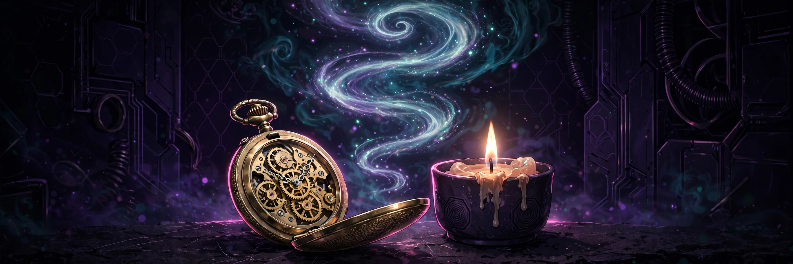

# Trancefall

## 18+ — Adults Only

This game contains adult content. It is intended only for players 18 and older.

### Content notes

- Hypnosis and trance induction are the central theme, set in an induction room
- Her facial expressions change as she is guided deeper into trance
- The session builds around counted breathing, ending on a counted exhale

All characters depicted are adults.

## A rhythm game where you tap on each count beat to walk Prima deeper into trance.

<a href="https://github.com/NTRanch/trancefall">GitHub</a> · <a href="https://github.com/NTRanch/trancefall/blob/main/LICENSE.md">License</a> · <a href="https://ntranch.itch.io">itch.io studio page</a> · <a href="https://github.com/NTRanch/trancefall/releases/tag/v1.0.0">Release</a>

## Built with

 

## What you do

Prima breathes in, holds, and on the exhale she counts. You tap — click or press Space — on each count beat to walk her deeper. As your timing lands, her face moves through changing expressions and the room around her deepens with her.

Each level asks for more: more beats in the count and a higher share of beats hit. Miss the rhythm and the descent stalls; hold it and the counted exhale carries her all the way down.

## Features

- Three levels of rising difficulty: First Descent (4 beats, 60% target), Down Easy (5 beats, 85% target), and Trandeep (6 beats, 97% target)
- Her face and the room's atmosphere deepen together as she goes under
- Settings for atmosphere density and text size, plus your best depth per level, persist in the browser

## Media

- [Level 1 preview](../docs/previews/level-1-trancefall.mp4)
- [Level 2 preview](../docs/previews/level-2-trancefall.mp4)
- [Level 3 preview](../docs/previews/level-3-trancefall.mp4)

## Controls

| Action | Keys |
| --- | --- |
| Tap on the count beat | Click or Space |

## Status

**v1.0.0** — complete. Built for the Torogao Jam Program (a 14-week, one-game-per-week programme) for the Gameotron jam on itch.io. This GitHub page is the game's home while itch project slots are unavailable. To play, open `web/index.html` in a browser — it is one self-contained file and runs fully offline. Free to play.

## Credits

A Nice Thoughts Ranch game.

Made with Zig.
